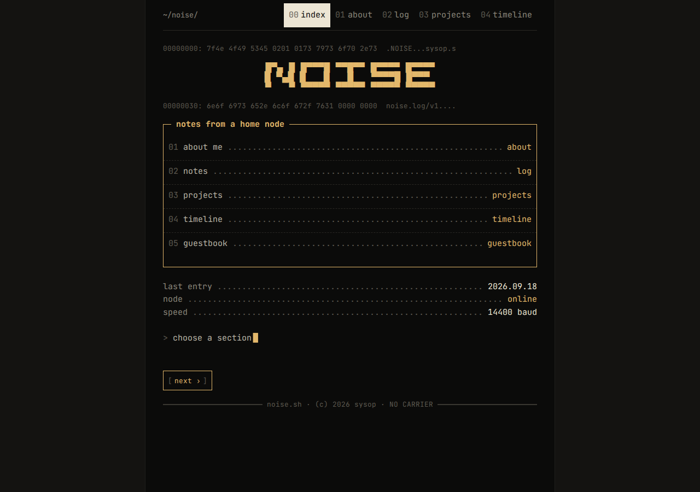
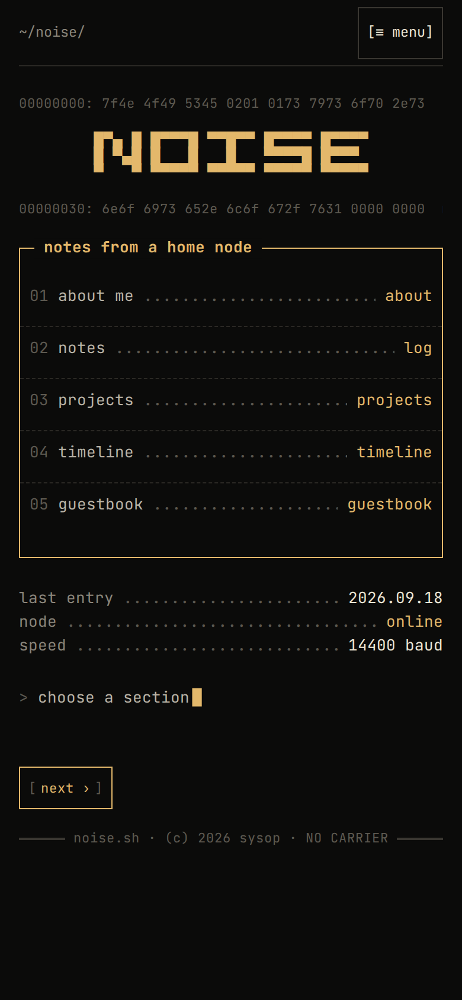
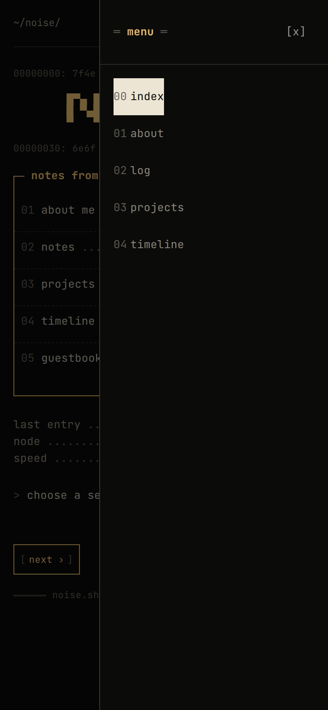
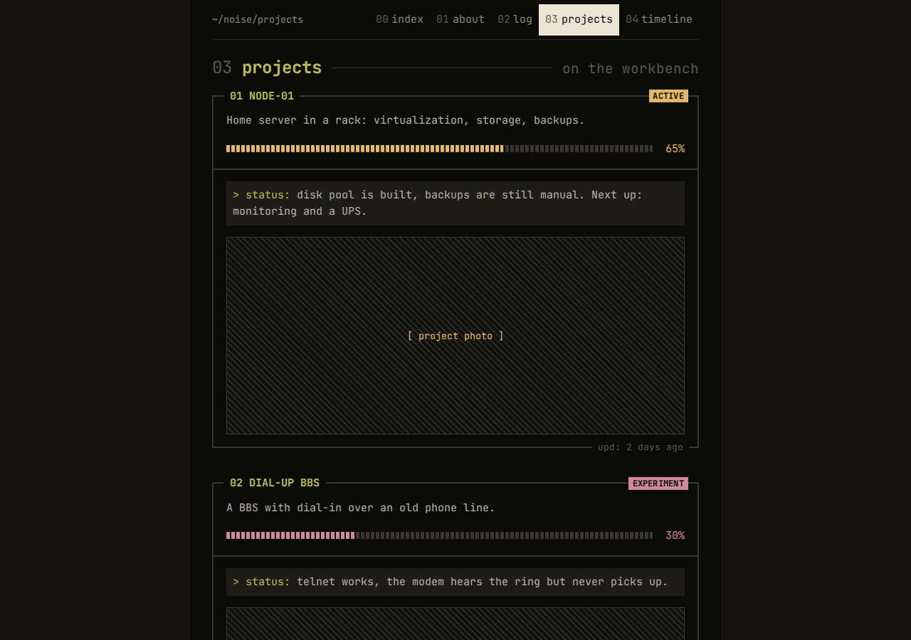

# bootstra-code437

A Bootstrap 5 theme inspired by ANSI art, BBS interfaces, DOS-era terminals, and IBM Code Page 437.

Write regular Bootstrap markup (grid, cards, buttons, navbar, offcanvas, forms) and get a textmode look: one monospace face, frames with titles set into the border line, `[ bracketed ]` buttons, dot leaders, `■■■□□` progress bars, hexdump headers, and a muted palette with per-section accent colors.



| Mobile | Mobile menu (offcanvas) | Projects |
|---|---|---|
|  |  |  |

## Quick start

Load the theme **after** Bootstrap and set the dark color mode:

```html
<!doctype html>
<html lang="en" data-bs-theme="dark">
<head>
  <meta charset="utf-8">
  <meta name="viewport" content="width=device-width, initial-scale=1, viewport-fit=cover">
  <link rel="stylesheet" href="https://fonts.googleapis.com/css2?family=JetBrains+Mono:wght@400;700&display=swap">
  <link rel="stylesheet" href="https://cdn.jsdelivr.net/npm/bootstrap@5.3.3/dist/css/bootstrap.min.css">
  <link rel="stylesheet" href="dist/code437.min.css">
</head>
<body>
  <div class="container-cp cp-amber">
    <h1 class="cp-h" data-n="01">hello</h1>
    <div class="card cp-round">
      <div class="card-header"><span>about</span></div>
      <div class="card-body">Regular Bootstrap card, textmode frame.</div>
    </div>
    <button class="btn btn-primary">connect</button>
  </div>
  <script src="https://cdn.jsdelivr.net/npm/bootstrap@5.3.3/dist/js/bootstrap.bundle.min.js"></script>
</body>
</html>
```

From npm:

```bash
npm install bootstrap bootstra-code437
```

Or from jsDelivr:

```html
<link rel="stylesheet" href="https://cdn.jsdelivr.net/npm/bootstra-code437@0.1/dist/code437.min.css">
```

The theme sets JetBrains Mono as its first font choice but does not ship it. Load it yourself (as in the Quick start) or the page falls back to IBM Plex Mono or the system monospace font.

## Examples

- `examples/index.html` — every component on one page
- `examples/blog.html` — a personal blog (about, log, projects, timeline) built with the theme

See them live in the [collection demo](https://bloschinsky.github.io/bootstra-html32/themes/bootstra-code437/), open them directly in a browser after a build, or run `npm start` and go to `http://localhost:3000/examples/`.

## Layout

Layout is plain Bootstrap: `row`, `col-*`, `g-*`, `d-flex`, spacing utilities all work as usual.

`.container-cp` is the page container: a centered text column (`--cp-col: 76ch`) on a slightly darker page background, so the page never fills the whole screen edge to edge.

## Tokens

All colors and sizes are CSS custom properties on `:root`. Override them after loading the theme:

```css
:root {
  --cp-page:    #141311;  /* background around the column */
  --cp-surface: #0b0b0a;  /* column background */
  --cp-raise:   #1d1c19;  /* hover, row highlight */
  --cp-line:    #2a2824;  /* hairlines */
  --cp-line-2:  #3a3731;  /* frames */
  --cp-dim:     #5d5950;  /* decoration: dots, hex */
  --cp-muted:   #8a857a;  /* secondary text */
  --cp-fg:      #b9b3a6;  /* body text */
  --cp-bright:  #ece5d4;  /* headings, inverse blocks */
  --cp-font:    "JetBrains Mono", "IBM Plex Mono", ui-monospace, monospace;
  --cp-col:     76ch;     /* text column width */
}
```

The theme also maps these onto Bootstrap's own variables (`--bs-body-bg`, `--bs-border-color`, `--bs-border-radius: 0`, …).

## Accents

Put an accent class on any container. Everything inside (links, frame titles, progress bars, badges, `.btn-primary`) picks it up. Giving each page its own accent is how the example blog gets a different feel per section.

| class | color |
|---|---|
| `.cp-amber` | `#e3b86b` (default) |
| `.cp-rose` | `#d08a9c` |
| `.cp-teal` | `#86b3a4` |
| `.cp-olive` | `#b7bd5a` |
| `.cp-orange` | `#e48a4e` |
| `.cp-steel` | `#7f95b8` |

Custom accent: `.my-section { --cp-acc: #9fc3e7; }`

## Restyled Bootstrap components

btn, btn-group, btn-close, navbar, nav-pills, nav-tabs, offcanvas, dropdown, breadcrumb, pagination, card, list-group, progress, badge, alert, table, form-control, form-select, form-check, form-switch, form-range, input-group, validation states, modal, accordion, tooltip, popover, toast. Spinners are hidden; use `.cp-spin` instead.

## Theme classes

| class | what it does |
|---|---|
| `.container-cp` | centered text column |
| `.cp-section` | vertical padding for a page section |
| `.cp-h[data-n]` | section heading with a number and a trailing rule |
| `.card.cp-round` / `.cp-heavy` / `.cp-double` / `.cp-dashed` / `.cp-acc-frame` | frame variants |
| `.card-header > *` | title set into the top line of the frame |
| `.card-footer` | label set into the bottom line, right side |
| `.cp-split` | full-width divider inside a frame |
| `.cp-lead` | row with a dot leader between its first and last child |
| `dl.cp-kv` | `key ........ value` list |
| `ul.cp-tags` | `~ tag ~ tag` row |
| `.cp-n` | dim number prefix inside nav, list and dropdown items |
| `.cp-progress` | wrapper for `.progress` plus a percentage |
| `.cp-state` | `> status: …` line |
| `.alert[data-cp-label]` | custom alert label, e.g. `!! error` |
| `.input-group.cp-prompt` | input with a `>` prompt |
| `.badge.cp-outline` | outlined badge |
| `.cp-pre`, `.cp-logo` | raw ASCII/ANSI blocks and block-letter logos |
| `.cp-hex` | hexdump line |
| `.cp-rule`, `-heavy`, `-double`, `-dots` | dividers |
| `.ratio.cp-photo[data-label]` | `▒▒` photo placeholder |
| `.cp-img`, `figure.cp-fig` | framed photo with a `↳` caption |
| `.cp-avatar` | square avatar with a double outline |
| `article.cp-entry[data-off][data-off-short]` | log entry with a hex gutter |
| `ol.cp-timeline`, `li.cp-now` | timeline: left rail on mobile, centered and alternating from `md` |
| `.cp-cursor`, `.cp-spin` | blinking cursor, text spinner |
| `.cp-sig` | signature strip for the page footer |
| `.cp-dim`, `.cp-muted`, `.cp-bright`, `.cp-acc` | text colors |

## Mobile

The theme is mobile-first. Interactive elements are at least 44px tall. For the menu, use Bootstrap's responsive offcanvas (`offcanvas-md`): a slide-in panel on phones and an inline row from `md` up. See `examples/blog.html`.

## Text labels and other languages

A few labels are generated by CSS. Override them for your language:

```css
:root {
  --cp-state-label: "> status: ";
  --cp-alert-label: "!! notice";
  --cp-now-label: " ← now";
}
```

## Build

This package lives in the [bootstra themes](https://github.com/bloschinsky/bootstra-html32) monorepo. From the repository root:

```bash
npm ci
npm run build --workspace bootstra-code437   # src/code437.css → dist/code437.css + dist/code437.min.css, demo → _site/
npm test --workspace bootstra-code437        # stylelint + build
```

`npm start` in this folder serves it locally with `npx serve`.

## Project structure

```
packages/bootstra-code437/
├── src/code437.css        theme source
├── dist/                  built files (code437.css, code437.min.css), generated
├── _site/                 demo for the collection site, generated
├── index.html             redirect to examples/
├── examples/              component page and blog example
├── docs/                  screenshots
└── scripts/build.mjs      build script
```

## Browser support

Current Chrome, Edge, Firefox and Safari. Uses CSS custom properties, `:has()`, `aspect-ratio`, and `env(safe-area-inset-*)`. Respects `prefers-reduced-motion`.

## Roadmap

- SCSS source with Bootstrap variable overrides
- Light "paper printout" mode
- More frame styles and ANSI color presets (CGA 16-color)
- A CP437 bitmap font option

## License

MIT, see [LICENSE](LICENSE).
